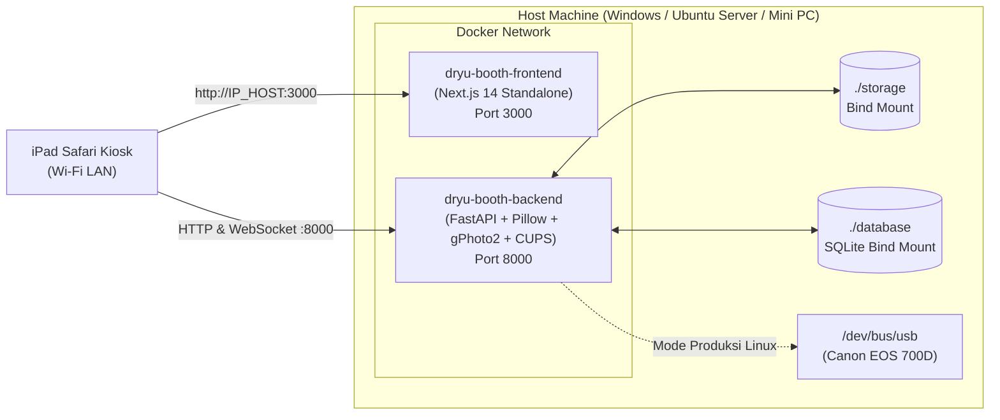

# Panduan Docker & Docker Compose - Dryu Photobooth

> Dokumentasi resmi untuk membangun, menjalankan, menguji, dan men-deploy sistem Dryu Photobooth (Backend FastAPI + Frontend Next.js Kiosk) menggunakan Docker dan Docker Compose.

---

## 1. Arsitektur Kontainer

Sistem terdiri dari 2 kontainer utama yang diorkestrasi melalui [`docker-compose.yml`](file:///c:/Users/ASUS%20TUF%20F15/dryu-booth/docker-compose.yml):



| Service | Nama Kontainer | Image Base | Port Host | Peran |
| :--- | :--- | :--- | :--- | :--- |
| **`backend`** | `dryu-booth-backend` | `python:3.12-slim` | `8000:8000` | Menjalankan FastAPI, SessionManager, SQLite, Pillow ImageProcessor, `gphoto2`, dan `cups-client`. |
| **`frontend`** | `dryu-booth-frontend` | `node:20-alpine` | `3000:3000` | Menjalankan UI Kiosk layar sentuh berbasis Next.js (mode *standalone*). |

---

## 2. Cara Menjalankan (Mode Simulasi / Development)

Mode ini berjalan di **Windows, macOS, maupun Linux** tanpa memerlukan kamera Canon EOS 700D fisik atau printer fisik (`CAMERA_DRIVER=simulation`, `PRINTER_DRIVER=simulation`).

### 2.1 Build dan Jalankan Kontainer
Dari direktori utama proyek (`dryu-booth/`), jalankan:

```bash
docker compose up -d --build
```

### 2.2 Verifikasi Status Kontainer
```bash
docker compose ps
```
Pastikan `dryu-booth-backend` berstatus `Up (healthy)` dan `dryu-booth-frontend` berstatus `Up`.

### 2.3 Akses Aplikasi
- **UI Kiosk (Layar Utama / iPad):** Buka `http://localhost:3000` (atau `http://<IP_LAN_SERVER>:3000` dari Safari di iPad).
- **Backend Swagger API Docs:** Buka `http://localhost:8000/docs`.
- **Healthcheck Endpoint:** Buka `http://localhost:8000/health`.

---

## 3. Cara Menjalankan di Linux / Mini PC dengan Kamera Fisik (USB Passthrough)

Pada **Ubuntu Server 24.04 LTS** (baik di VirtualBox maupun Mini PC fisik) ketika kamera **Canon EOS 700D** dan printer fisik (CUPS) sudah terhubung melalui USB, gunakan file override [`deployment/docker/docker-compose.usb.yml`](file:///c:/Users/ASUS%20TUF%20F15/dryu-booth/deployment/docker/docker-compose.usb.yml):

```bash
docker compose -f docker-compose.yml -f deployment/docker/docker-compose.usb.yml up -d --build
```

File override tersebut secara otomatis:
1. Mengaktifkan `CAMERA_DRIVER=gphoto` dan `PRINTER_DRIVER=cups`.
2. Meneruskan bus USB host (`/dev/bus/usb:/dev/bus/usb`) ke dalam kontainer backend.
3. Meneruskan socket CUPS host (`/run/cups/cups.sock:/run/cups/cups.sock`) agar kontainer dapat mencetak langsung ke printer host.

### Menguji Deteksi Kamera di Dalam Kontainer
```bash
docker exec -it dryu-booth-backend gphoto2 --auto-detect
```

---

## 4. Menjalankan Pengujian Otomatis (`pytest`) di Dalam Docker

Anda dapat menjalankan seluruh *test suite* (`tests/unit`, `tests/api`, dan `tests/simulation`) langsung di dalam kontainer:

```bash
docker compose run --rm -v ./tests:/app/tests backend pytest -v
```

---

## 5. Persistensi Data & Volume

Docker Compose memetakan (*bind mount*) folder lokal ke dalam kontainer agar seluruh hasil foto dan riwayat sesi tidak hilang ketika kontainer di-restart:
- `./storage:/app/storage` — Menyimpan foto asli (`captures/`), hasil strip siap cetak (`processed/`), dan thumbnail (`thumbnails/`).
- `./database:/app/database` — Menyimpan file database SQLite (`photobooth.db`) yang berisi tabel `sessions`, `photos`, dan `print_jobs`.
- `./templates:/app/templates` — Menyimpan aset template bingkai.

---

## 6. Perintah Operasional Sehari-hari

| Kebutuhan | Perintah |
| :--- | :--- |
| Melihat log live semua servis | `docker compose logs -f` |
| Melihat log backend saja | `docker compose logs -f backend` |
| Me-restart servis | `docker compose restart` |
| Menghentikan semua kontainer | `docker compose down` |
| Rebuild setelah mengubah kode | `docker compose up -d --build` |
