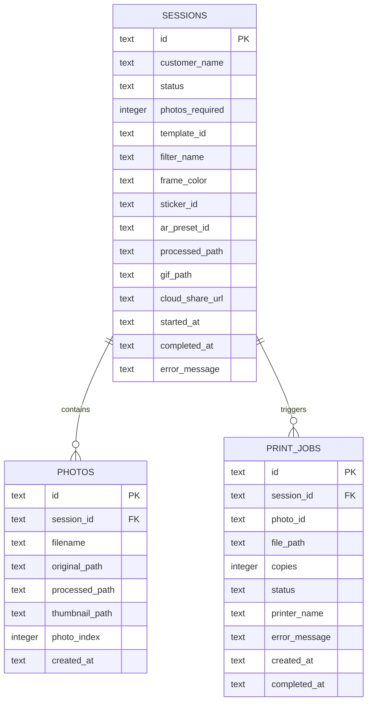

# Skema Database Lokal (SQLite) — Dryu Photobooth

Database lokal disimpan pada `database/photobooth.db` dan dikelola secara otomatis oleh [`DatabaseService`](file:///c:/Users/ASUS%20TUF%20F15/dryu-booth/backend/app/services/storage/database.py).

Saat aplikasi dijalankan, `DatabaseService._init_db()` otomatis membuat tabel jika belum ada serta menjalankan migrasi kolom baru (`ALTER TABLE sessions ADD COLUMN ...`) secara aman tanpa menghapus data lama.

---

## Diagram Relasi Entitas (ERD)

---

## Penjelasan Kolom Baru pada Tabel `sessions`

| Kolom | Tipe | Keterangan |
| :--- | :--- | :--- |
| `filter_name` | `TEXT` | ID filter yang diterapkan pada sesi (`original`, `beauty`, `bw`, `sepia`, `vintage`, `cool`, `y2k`, `vivid`). |
| `frame_color` | `TEXT` | ID tema warna bingkai (`pink`, `butter`, `mint`, `lavender`, `sky`, `cream`). |
| `sticker_id` | `TEXT` | Paket dekorasi stiker (`sweet_bows`, `hearts_only`, `flowers_only`, `sparkles_only`, `none`). |
| `ar_preset_id` | `TEXT` | ID preset AR wajah/stiker pilihan (`pink_bunny_sweet`, `cute_glasses_blush`, `kitty_whiskers`, `royal_princess`, `sakura_fairy`, `none`). |
| `processed_path` | `TEXT` | Path lokal ke file Strip JPEG hasil komposisi (`storage/processed/strip_<session_id>.jpg`). |
| `gif_path` | `TEXT` | Path lokal ke file Animasi Boomerang GIF (`storage/processed/gif_<session_id>.gif`). |
| `cloud_share_url` | `TEXT` | Tautan galeri digital tamu (`/share/<session_id>`) untuk pemindaian QR Code. |

---

## Catatan Perubahan Signifikan Skema Database

| Versi / Tanggal | Tabel | Perubahan | Deskripsi & Penanganan Migrasi |
| :--- | :--- | :--- | :--- |
| **v0.2.0** | `sessions` | Penambahan kolom `filter_name` & `frame_color` | Menyimpan preferensi visual foto sesi pelanggan untuk render ulang non-destruktif. |
| **v0.2.0** | `sessions` | Penambahan kolom `sticker_id` | Mendukung kustomisasi paket stiker dekoratif (`sweet_bows`, dll.). |
| **v0.3.0** | `sessions` | Penambahan kolom `ar_preset_id` | Menyimpan pilihan preset AR wajah/stiker pelanggan (`pink_bunny_sweet`, dll.) untuk komposisi non-destruktif. |
| **v0.2.0** | `sessions` | Penambahan kolom `gif_path` | Menyimpan path file Animasi Boomerang GIF yang otomatis dihasilkan per sesi. |
| **v0.2.0** | `sessions` | Penambahan kolom `cloud_share_url` | Menyimpan tautan microsite unduh tamu untuk generator QR Code Kiosk. |
| **Mekanisme Migrasi** | SQLite | `ALTER TABLE ... ADD COLUMN` | Dijalankan otomatis saat `DatabaseService._init_db()` mendeteksi database lama tanpa merusak data sesi yang sudah ada. |
