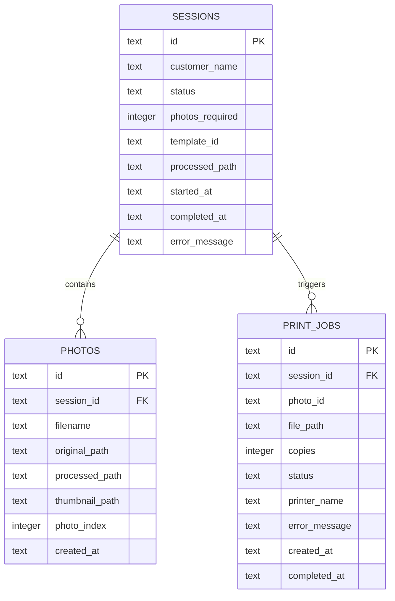

# Skema Database Lokal (SQLite) - Dryu Photobooth

Database lokal disimpan pada `database/photobooth.db` dan dikelola secara otomatis oleh [`DatabaseService`](file:///c:/Users/ASUS%20TUF%20F15/dryu-booth/backend/app/services/storage/database.py).

---

## Diagram Relasi Entitas (ERD)

