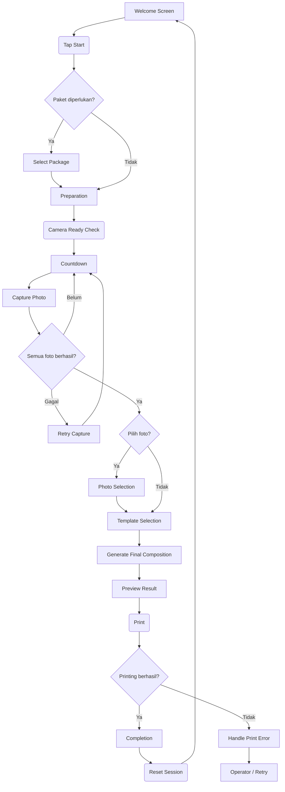
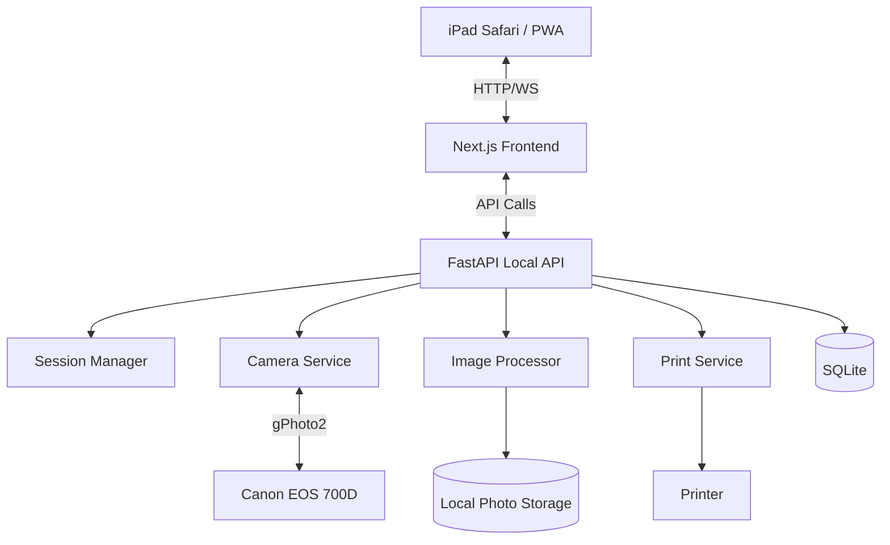

# Rancangan UI/UX Photobooth — Sweet, Cute & Memorable 🎀

Untuk project photobooth kamu yang menggunakan iPad sebagai touchscreen, Canon EOS 700D sebagai kamera, dan Mini PC sebagai local server, saya menyarankan desain yang menggabungkan estetika *Korean-style photobooth*, *scrapbook*, dan *soft pastel*.

Targetnya bukan sekadar membuat aplikasi terlihat lucu. Pengunjung harus bisa menggunakan photobooth tanpa bantuan operator, mulai dari memilih paket, berpose, mengambil foto, memilih hasil, hingga mencetak foto.

Menurut saya, konsep yang paling cocok adalah **Sweet Studio — a little moment, a lovely memory**.

---

## 1. Konsep visual: Sweet Studio

**Arah desain**

| Elemen | Rekomendasi |
| :--- | :--- |
| **Gaya** | Sweet, playful, modern, Korean-inspired |
| **Warna utama** | Baby pink `#F6C9D2` |
| **Warna latar** | Warm cream `#FFF9F2` |
| **Warna sekunder** | Lavender `#DCD6F7` |
| **Warna aksen** | Strawberry red `#E98291` |
| **Warna teks** | Dark cocoa `#493B3B` |
| **Font heading** | Quicksand atau Nunito |
| **Font pendukung** | Inter atau Nunito Sans |
| **Bentuk komponen** | Rounded corners, pill buttons, soft shadows |
| **Dekorasi** | Bintang, pita, hati, bunga kecil, doodle |
| **Animasi** | Fade, bounce ringan, countdown, sticker pop |

**Prinsip penting:** Desain harus terasa manis, tetapi tidak sampai mengganggu foto. Area preview kamera harus tetap menjadi fokus utama.

Saya akan membagi UI menjadi dua lapisan:
- **Lapisan pengguna:** Tampilan full-screen di iPad yang sederhana, menyenangkan, dan mudah disentuh.
- **Lapisan operator:** Dashboard untuk memeriksa kamera, printer, penyimpanan, dan riwayat sesi.

Keduanya sebaiknya menggunakan sistem desain yang sama, tetapi memiliki tujuan berbeda.

---

## 2. Struktur halaman aplikasi

Untuk layar iPad, saya menyarankan aplikasi menggunakan orientasi **landscape** jika booth memiliki layar horizontal, atau **portrait** jika desain fisik booth lebih cocok vertikal. Sebelum implementasi, ukuran dan orientasi iPad perlu dipastikan.

**Struktur halaman utamanya:**

| No | Halaman | Tujuan | Prioritas |
| :--- | :--- | :--- | :--- |
| 1 | **Welcome** | Menyambut pengunjung | Sangat tinggi |
| 2 | **Package Selection** | Memilih paket foto | Kondisional |
| 3 | **Preparation** | Instruksi dan persiapan | Tinggi |
| 4 | **Countdown & Capture** | Mengambil foto | Sangat tinggi |
| 5 | **Photo Selection** | Memilih foto terbaik | Kondisional |
| 6 | **Template Selection** | Memilih desain frame | Tinggi |
| 7 | **Preview** | Memeriksa hasil akhir | Tinggi |
| 8 | **Printing** | Mencetak foto | Sangat tinggi |
| 9 | **Completion** | Menyelesaikan sesi | Tinggi |

*Catatan: Halaman paket dan pembayaran dapat dihilangkan jika booth menggunakan sistem gratis atau paket sudah ditentukan operator.*

---

## 3. Rancangan UI setiap halaman

### A. Welcome screen — halaman pembuka
Ini adalah halaman pertama yang dilihat pengunjung. Tujuannya membuat orang tertarik untuk mencoba dan memahami cara memulainya dalam beberapa detik.

**Komposisi UI:**
```text
┌──────────────────────────────────────────────┐
│                  ✦ SWEET STUDIO ✦            │
│                                              │
│             every moment is lovely           │
│                                              │
│           [ Ilustrasi foto polaroid ]        │
│               ♡  🎀  ✿  ♡                    │
│                                              │
│            Let's make memories!              │
│                                              │
│          ┌──────────────────────┐            │
│          │   START PHOTO  ♡     │            │
│          └──────────────────────┘            │
│                                              │
│              Touch to begin                  │
└──────────────────────────────────────────────┘
```

**UX yang disarankan:**
- Tombol `Start` menjadi elemen paling menonjol.
- Hindari menu yang terlalu banyak.
- Gunakan animasi dekorasi yang sangat ringan.
- Tambahkan preview contoh hasil foto agar pengunjung tertarik.
- Setelah beberapa waktu tidak aktif, aplikasi kembali ke halaman awal.
- Musik atau efek suara dapat menjadi opsi, bukan keharusan.
- Tombol utama sebaiknya memiliki area sentuh yang besar, sekitar 60–72 piksel CSS atau lebih, agar nyaman digunakan.

### B. Package selection — memilih paket
Halaman ini digunakan jika kamu menawarkan beberapa paket, misalnya paket reguler dan premium.

```text
┌──────────────────────────────────────────────┐
│  ← Back             CHOOSE YOUR PACKAGE      │
│                                              │
│   ┌──────────────┐    ┌──────────────┐       │
│   │   ♡ BASIC    │    │  ✨ PREMIUM  │       │
│   │              │    │              │       │
│   │  2 strips    │    │  4 strips    │       │
│   │  4 photos    │    │  8 photos    │       │
│   │              │    │              │       │
│   │  [ SELECT ]  │    │  [ SELECT ]  │       │
│   └──────────────┘    └──────────────┘       │
│                                              │
└──────────────────────────────────────────────┘
```

**UX:**
- Tampilkan perbedaan paket dengan jelas.
- Harga harus terlihat jika paket berbayar.
- Jangan menggunakan deskripsi yang terlalu panjang.
- Berikan penanda pada paket populer jika memang ada.
- Jika menggunakan QRIS, tampilkan langkah pembayaran setelah paket dipilih dan verifikasi pembayaran dilakukan oleh sistem yang terintegrasi.
- *Untuk versi awal, saya menyarankan paket ditentukan oleh konfigurasi operator sehingga halaman ini bisa dilewati jika belum dibutuhkan.*

### C. Preparation screen — bersiap untuk foto
Sebelum kamera mengambil foto, berikan instruksi singkat.

```text
┌──────────────────────────────────────────────┐
│                                              │
│               READY, CUTIES? ♡               │
│                                              │
│           ┌────────────────────┐             │
│           │                    │             │
│           │   CAMERA PREVIEW   │             │
│           │                    │             │
│           └────────────────────┘             │
│                                              │
│       Stand here and look at the camera      │
│                                              │
│          [ I'M READY!  ✿ ]                   │
│                                              │
└──────────────────────────────────────────────┘
```

**UX penting:**
- Tampilkan preview kamera jika Live View sudah berhasil diintegrasikan.
- Berikan indikator kamera siap atau tidak siap.
- Jelaskan jumlah foto yang akan diambil.
- Sediakan tombol untuk memulai sesi pengambilan foto.
- Jika kamera belum terhubung, jangan biarkan pengunjung masuk ke proses capture.
- Jika Live View belum stabil, halaman ini masih bisa menggunakan ilustrasi posisi berdiri dan petunjuk arah kamera.

### D. Countdown & capture — inti photobooth
Halaman ini harus memiliki desain paling fokus. Jangan terlalu banyak elemen yang mengalihkan perhatian.

```text
┌──────────────────────────────────────────────┐
│                PHOTO 1 OF 4                  │
│                                              │
│             ┌──────────────────┐             │
│             │                  │             │
│             │  CAMERA PREVIEW  │             │
│             │                  │             │
│             └──────────────────┘             │
│                                              │
│                     3                        │
│                                              │
│             Get ready to pose! ♡             │
│                                              │
│          ● ○ ○ ○     1 / 4 photos            │
└──────────────────────────────────────────────┘
```

**Perilaku UI:**
1. Sistem memulai countdown, misalnya 3–2–1.
2. Angka countdown muncul besar di tengah layar.
3. Kamera mengambil foto.
4. Sistem mengunduh foto ke local server.
5. UI menunjukkan animasi shutter singkat.
6. Sistem memperbarui indikator jumlah foto.
7. Countdown berikutnya dimulai setelah kamera siap.
8. Setelah seluruh foto berhasil diambil, sistem berpindah ke tahap berikutnya.

**Aturan teknis yang penting:**
- Animasi countdown **tidak boleh** dianggap sebagai bukti bahwa foto berhasil diambil. Backend harus mengonfirmasi capture dan transfer foto sebelum melanjutkan.
- Jika kamera gagal mengambil foto, tampilkan pesan ramah dan pilihan mencoba kembali. Jangan langsung mengurangi jumlah foto yang tersisa atau menandai sesi selesai.

### E. Photo selection — memilih foto terbaik
Halaman ini bersifat opsional. Jika kamu ingin pengalaman yang cepat, semua foto dapat langsung digunakan. Jika diaktifkan, pengunjung bisa melihat thumbnail hasil foto dan memilih foto favorit.

```text
┌──────────────────────────────────────────────┐
│              PICK YOUR FAVORITES ♡           │
│                                              │
│    ┌─────────┐ ┌─────────┐ ┌─────────┐       │
│    │ PHOTO 1 │ │ PHOTO 2 │ │ PHOTO 3 │       │
│    │   ♡     │ │   ✓     │ │   ♡     │       │
│    └─────────┘ └─────────┘ └─────────┘       │
│                                              │
│    ┌─────────┐                               │
│    │ PHOTO 4 │                               │
│    │   ♡     │                               │
│    └─────────┘                               │
│                                              │
│          [ CONTINUE  → ]                     │
└──────────────────────────────────────────────┘
```

**UX:**
- Thumbnail harus cukup besar untuk melihat ekspresi.
- Foto terpilih memiliki border dan ikon yang jelas.
- Batasi waktu memilih agar booth tidak tertahan terlalu lama.
- Sediakan opsi melanjutkan tanpa mengubah pilihan jika paket tidak memerlukan seleksi.
- *Perlu dibedakan antara memilih foto yang akan digunakan dan mengambil ulang foto. Pengambilan ulang harus memiliki aturan jumlah percobaan agar waktu sesi tetap terkendali.*

### F. Template selection — memilih frame
Ini adalah salah satu bagian yang dapat memberikan identitas visual pada brand photobooth.

```text
┌──────────────────────────────────────────────┐
│              PICK YOUR VIBE ✨               │
│                                              │
│   ┌──────────┐ ┌──────────┐ ┌──────────┐     │
│   │  PINK    │ │  CREAM   │ │ LAVENDER │     │
│   │  FRAME   │ │  FRAME   │ │  FRAME   │     │
│   │   ♡      │ │   ✿      │ │   ☆      │     │
│   └──────────┘ └──────────┘ └──────────┘     │
│                                              │
│          [ CHOOSE THIS FRAME ]               │
│                                              │
└──────────────────────────────────────────────┘
```

Setiap kartu menampilkan thumbnail template lengkap dengan contoh foto.
Kategori template yang bisa disediakan: Sweet Pink, Vintage Film, Minimal Cream, Lavender Dream, Birthday Edition, Couple Edition.

**UX:**
- Gunakan thumbnail hasil komposisi, bukan sekadar kotak warna.
- Tampilkan preview ukuran cetak.
- Pilihan yang aktif harus terlihat jelas.
- Sediakan template default jika pengunjung tidak memilih.
- Template dapat dikelola operator tanpa harus mengubah kode aplikasi.
- *Untuk versi awal, gunakan 3–5 template yang benar-benar siap cetak. Terlalu banyak pilihan justru memperlambat pengalaman.*

### G. Preview — melihat hasil akhir
Halaman preview memberikan kesempatan terakhir kepada pengunjung untuk melihat hasil sebelum dicetak.

```text
┌──────────────────────────────────────────────┐
│                YOUR MEMORIES ♡               │
│                                              │
│            ┌─────────────────┐               │
│            │                 │               │
│            │  FINAL PHOTO    │               │
│            │   COMPOSITION   │               │
│            │                 │               │
│            └─────────────────┘               │
│                                              │
│       [ CHANGE FRAME ]   [ PRINT! ]          │
│                                              │
└──────────────────────────────────────────────┘
```

**UX:**
- Preview harus menggunakan hasil komposisi yang sama dengan file cetak.
- Jangan melakukan cropping ulang secara berbeda ketika proses printing.
- Tombol Print menjadi aksi utama.
- Jika pengunjung mengubah template, hasil preview harus diperbarui.
- Setelah proses cetak dimulai, cegah tombol Print ditekan berulang kali.

### H. Printing — proses cetak

```text
┌──────────────────────────────────────────────┐
│                                              │
│                  ✿                           │
│                                              │
│             PRINTING YOUR JOY                │
│                                              │
│           Your memories are on               │
│                 their way!                   │
│                                              │
│              [ PRINT STATUS ]                │
│                                              │
│         Please wait a little moment ♡        │
│                                              │
└──────────────────────────────────────────────┘
```

**UX dan teknis:**
- Tampilkan status pekerjaan cetak berdasarkan status dari backend.
- Jangan hanya menggunakan animasi loading tanpa mengetahui status printer.
- Jika printer offline, tampilkan pesan yang tidak membingungkan.
- Jika pekerjaan gagal, simpan statusnya agar operator bisa memeriksa dan mencoba kembali.
- Gunakan ID unik untuk setiap print job agar klik berulang tidak menghasilkan cetakan duplikat.

### I. Completion — sesi selesai

```text
┌──────────────────────────────────────────────┐
│                                              │
│                   ♡                          │
│                                              │
│              THANK YOU!                      │
│                                              │
│          Hope you love your photos!          │
│                                              │
│              [ START AGAIN ]                 │
│                                              │
│            See you next time ✿               │
│                                              │
└──────────────────────────────────────────────┘
```

- Jika fitur berbagi foto sudah tersedia, kamu bisa menambahkan QR code untuk mengunduh hasil digital.
- Jangan menampilkan QR code yang mengarah ke file lokal atau URL sementara yang tidak dapat diakses oleh ponsel pengunjung. Gunakan URL yang dapat diakses melalui jaringan atau layanan cloud sesuai desain sistem.
- Setelah sesi selesai, sistem harus membersihkan *state* UI dan kembali ke welcome screen. Foto dan metadata sesi tetap disimpan sesuai kebijakan retensi yang ditetapkan.

---

## 4. User flow — alur lengkap pengunjung

Saya menyarankan dua jenis flow: *happy path*, yaitu alur normal saat semuanya berjalan baik, dan *exception flow*, yaitu alur ketika terjadi masalah.

### 4.1 Happy path



### 4.2 Alur waktu yang disarankan
Untuk satu sesi yang mengambil empat foto:

| Tahap | Estimasi durasi |
| :--- | :--- |
| Welcome dan mulai | 3–5 detik |
| Persiapan | 5–10 detik |
| Capture 4 foto | 15–25 detik |
| Memilih foto | 5–10 detik |
| Memilih template | 5–10 detik |
| Preview dan konfirmasi | 5–10 detik |
| Proses cetak | Bergantung printer |

Target awal yang masuk akal adalah sekitar **45–70 detik** sebelum pencetakan dimulai, di luar waktu tunggu printer. Ini hanya estimasi desain; waktu sebenarnya perlu diukur menggunakan EOS 700D dan printer yang dipilih.
Untuk menjaga antrean tetap lancar, hindari animasi yang terlalu panjang dan perpindahan halaman yang tidak diperlukan.

---

## 5. Exception flow — ketika terjadi masalah

Photobooth tidak boleh hanya dirancang untuk kondisi normal. Sistem harus tetap mudah dipahami ketika kamera terputus, printer kehabisan kertas, atau proses pemrosesan gambar gagal.

| Masalah | Respons UI | Respons backend |
| :--- | :--- | :--- |
| **Kamera tidak terhubung** | Pesan bahwa kamera sedang tidak siap | Tandai camera unavailable |
| **Capture gagal** | Tawarkan pengambilan ulang | Catat error dan pertahankan status sesi |
| **Foto gagal diunduh** | Beri tahu bahwa foto belum tersimpan | Jangan lanjut sebelum transfer berhasil atau kegagalan ditangani |
| **Image processing gagal**| Tampilkan opsi mencoba kembali | Pertahankan file asli dan log error |
| **Printer offline** | Tampilkan bahwa pencetakan tertunda | Simpan print job untuk ditangani |
| **Internet terputus** | Fitur lokal tetap berjalan | Tunda sinkronisasi cloud |
| **Pengunjung pergi** | Kembali ke welcome setelah timeout aman| Batalkan atau tutup sesi sesuai statusnya |

**Prinsip utama:** Backend adalah sumber kebenaran status sistem. UI hanya menampilkan status yang diterima dari backend. Misalnya, tampilan tidak boleh menyatakan *Printing Complete* hanya karena animasi selesai. Status tersebut harus berasal dari konfirmasi pekerjaan cetak.

---

## 6. UX khusus untuk iPad kiosk

Karena pengunjung akan menggunakan layar sentuh tanpa keyboard atau mouse, interaksi harus dibuat sesederhana mungkin.

**A. Ukuran tombol**
- Tombol utama: tinggi 64–76 piksel CSS.
- Tombol sekunder: tinggi minimal sekitar 48–56 piksel CSS.
- Jarak antartombol: sekitar 12–16 piksel CSS.
- Hindari tombol kecil di sudut layar.
- Gunakan teks yang jelas, bukan ikon saja.
*(Angka tersebut merupakan target desain, bukan ukuran fisik layar. Ukuran akhir perlu diuji pada model iPad yang digunakan).*

**B. Navigasi yang sederhana**
Jangan membuat navigasi seperti website biasa yang penuh menu. Pada layar pengunjung, cukup gunakan:
- Tombol `Back` jika aman digunakan.
- Tombol `Continue`.
- Tombol `Retry` ketika diperlukan.
- Tombol `Print`.
- Tombol `Start Again`.
*(Jangan menampilkan menu administrasi di antarmuka pengunjung).*

**C. Pengelolaan waktu**
Sesi harus mempunyai timeout, tetapi jangan terlalu agresif.
- **Welcome screen:** animasi idle berjalan terus secara ringan.
- **Persiapan:** beri waktu yang cukup untuk pengguna bersiap.
- **Photo selection:** tampilkan pengingat ketika waktu hampir habis.
- **Preview:** jika tidak ada respons, gunakan kebijakan timeout yang jelas.
- **Printing:** jangan mengakhiri sesi hanya karena waktu tunggu mencapai batas.
*(Jika sesi berbayar, timeout tidak boleh menyebabkan pengguna kehilangan hak atas foto yang sudah dibayar).*

**D. Aksesibilitas**
- Pastikan kontras teks cukup tinggi.
- Gunakan teks yang mudah dibaca dari posisi berdiri.
- Jangan hanya membedakan status menggunakan warna.
- Sediakan ikon dan teks untuk status berhasil atau gagal.
- Hindari animasi berkedip cepat.
- Pastikan aplikasi tetap dapat digunakan ketika suara dimatikan.

---

## 7. UI operator — dashboard administrasi

Selain antarmuka pengunjung, kamu membutuhkan dashboard untuk memantau kondisi booth. Dashboard ini sebaiknya tidak muncul dalam flow pengunjung. Aksesnya dapat melalui halaman admin terpisah dengan autentikasi.

**Tampilan dashboard:**
```text
┌──────────────────────────────────────────────────────────┐
│ SWEET STUDIO ADMIN                        System Online  │
├──────────────┬───────────────────────────────────────────┤
│              │                                           │
│ Dashboard    │  CAMERA           PRINTER                 │
│ Sessions     │  ● Connected      ● Ready                 │
│ Templates    │                                           │
│ Print Jobs   │  STORAGE          NETWORK                 │
│ Settings     │  68% Used         ● LAN Connected         │
│              │                                           │
│              │  TODAY'S SESSIONS                         │
│              │  ┌─────────────────────────────────────┐  │
│              │  │ Total Sessions       42             │  │
│              │  │ Successful Prints    39             │  │
│              │  │ Failed Jobs           3             │  │
│              │  └─────────────────────────────────────┘  │
│              │                                           │
│              │  Recent Sessions                          │
│              │  Session ID | Status | Time               │
└──────────────┴───────────────────────────────────────────┘
```

**Fitur admin yang saya rekomendasikan:**
| Fitur | Keterangan |
| :--- | :--- |
| **System status** | Status API, kamera, printer, dan storage |
| **Session history** | Riwayat sesi photobooth |
| **Print jobs** | Daftar cetakan berhasil, tertunda, atau gagal |
| **Template management**| Tambah, edit, aktifkan, dan nonaktifkan template |
| **Storage management** | Pemantauan kapasitas disk |
| **Camera diagnostics** | Tes koneksi dan capture |
| **Printer diagnostics**| Tes status dan cetak |
| **Configuration** | Jumlah foto, countdown, timeout, dan ukuran cetak |
| **Logs** | Riwayat error untuk troubleshooting |

*Penting: Pengunjung dan operator sebaiknya memiliki hak akses berbeda. Pengunjung hanya boleh menjalankan flow photobooth, sedangkan perubahan konfigurasi dan akses foto harus dibatasi untuk operator.*

---

## 8. Design system yang konsisten

Supaya aplikasi terlihat profesional, jangan menentukan warna, ukuran, dan bentuk tombol secara terpisah pada setiap halaman. Buat design system sederhana.

**Color tokens**
| Token | Warna | Penggunaan |
| :--- | :--- | :--- |
| `background` | `#FFF9F2` | Latar halaman |
| `surface` | `#FFFFFF` | Kartu dan panel |
| `primary` | `#F6C9D2` | Tombol utama dan dekorasi |
| `primary-strong`| `#E98291` | Hover, active, aksen |
| `secondary` | `#DCD6F7` | Aksen sekunder |
| `text-primary` | `#493B3B` | Teks utama |
| `text-muted` | `#887B7B` | Teks sekunder |
| `success` | `#54866A` | Status berhasil |
| `error` | `#B84C58` | Status gagal |

*Warna status sebaiknya tidak hanya dibedakan melalui warna. Tambahkan ikon dan label teks.*

**Komponen UI (Struktur Folder)**
Buat komponen yang dapat digunakan kembali:
```text
frontend/components/
├── ui/
│   ├── Button.tsx
│   ├── Card.tsx
│   ├── Modal.tsx
│   ├── ProgressIndicator.tsx
│   └── StatusBadge.tsx
│
├── kiosk/
│   ├── WelcomeScreen.tsx
│   ├── PreparationScreen.tsx
│   ├── CountdownOverlay.tsx
│   ├── CameraPreview.tsx
│   ├── PhotoSelection.tsx
│   ├── TemplateSelector.tsx
│   ├── PhotoPreview.tsx
│   ├── PrintingScreen.tsx
│   └── CompletionScreen.tsx
│
└── admin/
    ├── Dashboard.tsx
    ├── CameraStatus.tsx
    ├── PrinterStatus.tsx
    ├── SessionTable.tsx
    └── TemplateManager.tsx
```
*Nama dan pembagian komponen ini merupakan rancangan awal; tidak semua komponen harus dibuat sekaligus.*

---

## 9. Menghubungkan UI dengan arsitektur sistem

Desain yang bagus perlu didukung oleh alur teknis yang benar.



Setiap aksi pengguna harus diterjemahkan menjadi perintah yang jelas. Contoh ketika pengunjung menekan `Start Photo`:
1. Frontend mengirim permintaan ke backend.
2. Backend membuat sesi dan ID sesi.
3. Backend memeriksa status kamera.
4. Backend memastikan tidak ada sesi lain yang sedang menggunakan kamera.
5. Backend memulai proses capture.
6. Frontend menerima pembaruan status.
7. Setelah foto berhasil diunduh, backend menyimpan metadata dan file.
8. Frontend menampilkan hasil yang telah dikonfirmasi backend.

Gunakan **WebSocket** untuk pembaruan status real-time jika dibutuhkan. Untuk versi awal, polling berkala juga cukup, asalkan status sesi ditangani secara konsisten.

**Keamanan dan privasi:**
Karena foto pengunjung adalah data pribadi, sistem juga harus memperhatikan:
- Pembatasan akses ke foto dan endpoint admin.
- Penghapusan foto berdasarkan kebijakan retensi.
- Tidak menampilkan sesi sebelumnya kepada pengunjung baru.
- Tidak menyimpan token atau kredensial di frontend.
- Pembatasan akses API agar perangkat lain di jaringan tidak dapat mengendalikan kamera tanpa izin.
- Pemisahan data sesi jika nanti ada pembayaran atau transaksi.

---

## 10. Rekomendasi MVP: mulai dari versi sederhana

Saya tidak menyarankan membuat semua fitur sekaligus. Buat versi minimum yang sudah bisa digunakan dari awal hingga akhir.

**MVP versi 1**

**Pengunjung:**
1. Welcome screen.
2. Tombol Start.
3. Countdown.
4. Capture empat foto.
5. Memilih template dari tiga pilihan.
6. Preview hasil.
7. Cetak.
8. Completion screen.

**Operator:**
1. Login admin.
2. Status kamera.
3. Status printer.
4. Riwayat sesi.
5. Pengelolaan template sederhana.

**Backend:**
1. Camera service dengan mode simulasi dan mode EOS 700D.
2. Session manager.
3. Image processing.
4. Print service.
5. SQLite.
6. Logging dan error handling.

*Fitur pemilihan paket, QRIS, cloud sharing, dan statistik lanjutan bisa ditambahkan setelah alur dasar stabil.*

**Urutan implementasi:**

| Tahap | Pekerjaan | Kriteria selesai |
| :--- | :--- | :--- |
| **1** | Membuat design system | Warna, font, tombol, dan kartu konsisten |
| **2** | Membuat UI dengan data simulasi | Seluruh flow bisa dicoba tanpa kamera |
| **3** | Membuat session manager | Status sesi konsisten |
| **4** | Integrasi EOS 700D | Capture dan transfer foto berhasil |
| **5** | Image processing | Hasil sesuai template |
| **6** | Integrasi printer | Hasil dapat dicetak |
| **7** | Pengujian di iPad | Touchscreen dan navigasi berjalan baik |
| **8** | Pengujian end-to-end | Sesi lengkap berjalan tanpa intervensi operator |

**Keputusan desain akhir yang saya sarankan:**
- **Tema:** Sweet Studio, Korean-inspired pastel.
- **UI pengunjung:** Full-screen kiosk, minim navigasi.
- **UI operator:** Dashboard terpisah.
- **Frontend:** Next.js + TypeScript.
- **Backend:** FastAPI.
- **Kamera:** Canon EOS 700D melalui gPhoto2.
- **Database:** SQLite.
- **Pengembangan awal:** Seluruh UI dapat diuji dengan kamera simulasi sebelum USB passthrough siap.

Dengan pendekatan ini, kamu bisa menyelesaikan desain dan flow terlebih dahulu tanpa harus menunggu integrasi kamera berhasil. Langkah paling tepat berikutnya adalah membuat mockup visual untuk seluruh layar MVP, lalu menerjemahkannya menjadi komponen Next.js. Setelah mockup disetujui, kita dapat mengimplementasikan halaman secara bertahap dengan alur yang sudah ditetapkan.

---

## 9. Catatan Perubahan Signifikan Realisasi UI/UX (LumaBooth Parity)

| Komponen Layar | Perubahan Signifikan yang Direalisasikan |
| :--- | :--- |
| **WelcomeScreen** | Penambahan integrasi PaymentModal otomatis saat tombol mulai disentuh (QRIS dinamis dan voucher kasir). |
| **PreparationScreen** | Penambahan pemilih sumber kamera (`Kamera Perangkat / USB Capture Card` vs `Kamera Server Wi-Fi`), daftar input video, pemilih filter live 8 varian, dan durasi timer (1s/3s/5s). |
| **CountdownOverlay** | Penambahan tombol **Jepret Sekarang 📸** di kanan bawah untuk potret instan, Web Audio synthesizer (beep countdown & shutter sound), dan layar tinjauan foto 5 detik antar-pose dengan tombol **Foto Ulang ↺**. |
| **PhotoSelection** | Layar seleksi interaktif yang memungkinkan pelanggan memilih foto terbaik dari 6 pose sesuai jumlah slot frame template. |
| **TemplateSelector** | Kustomisasi sekunder di mana pelanggan dapat mengganti warna bingkai, filter, paket stiker, dan teks kustom sebelum cetak. |
| **PhotoPreview** | Tampilan dual-tab untuk mempratinjau hasil cetak **Strip JPEG** dan **Animasi Boomerang GIF** sebelum dikirim ke printer. |
| **CompletionScreen** | Penyajian QR code yang mengarahkan tamu ke microsite galeri pribadi (`/share/[sessionId]`) untuk mengunduh Strip JPEG, Boomerang GIF, dan seluruh foto asli ke smartphone. |
| **Sound Engine** | Synthesizer Web Audio API murni di `lib/sound.ts` (countdown beep, shutter click, success chime) tanpa file MP3 eksternal. |