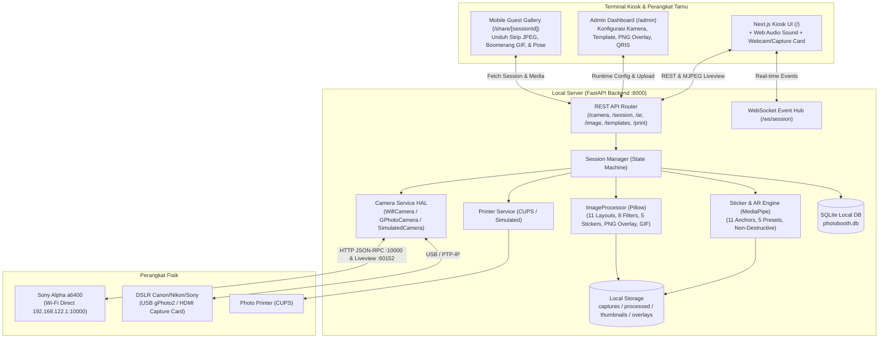
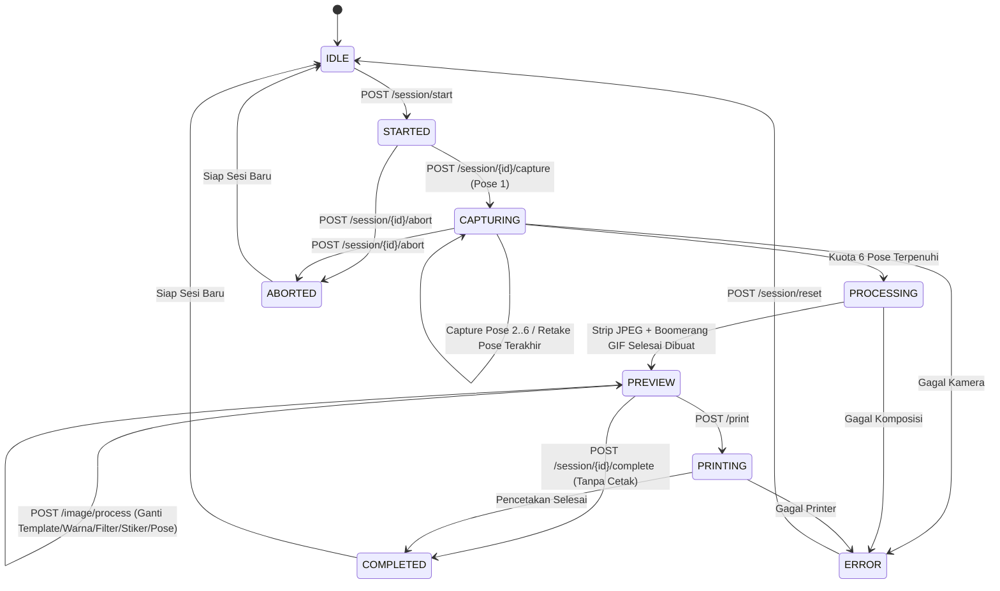

# Dokumentasi Sistem Photobooth Otomatis (Dryu Photobooth — Sweet Studio)

> Sumber rujukan utama rancangan arsitektur, spesifikasi fitur, alur sesi 8-langkah, state machine, struktur data, dan daftar endpoint API terkini.

---

## 1. Ringkasan Sistem
**Dryu Photobooth** dirancang sebagai sistem photobooth mandiri (*local-first* & *offline-capable*) dengan fitur setara **LumaBooth**:
- **Antarmuka Kiosk Layar Sentuh (`/`):** Pengalaman interaktif 8-langkah bertema pastel *Sweet Studio*, lengkap dengan hitung mundur bersuara (Web Audio API), tinjauan antar-foto 5 detik (*auto-next* atau *retake*), pemilihan pose terbaik, kustomisasi warna bingkai, stiker, filter, serta tombol **Jepret Sekarang 📸**.
- **Dashboard Operator (`/admin`):** Pemantauan kesehatan sistem, konfigurasi driver kamera *runtime* (`simulation`, `gphoto` USB, `wifi` Sony a6400), manajemen 11 template, unggah *Custom PNG Frame Overlay*, pengaturan pembayaran QRIS/Voucher, dan riwayat sesi/cetakan.
- **Galeri Digital Tamu (`/share/[sessionId]`):** Halaman web *mobile-first* yang diakses melalui QR Code untuk mengunduh **Strip Foto (JPEG)**, **Animasi Boomerang (GIF)**, dan **Foto Asli per-Pose**.
- **Multi-Kamera (Wi-Fi / Capture Card / USB / Simulasi):** Mendukung **Sony Alpha a6400** tanpa kabel via Wi-Fi Direct (`192.168.122.1:10000`), kamera via HDMI Capture Card/Webcam di browser, maupun tethering USB `gphoto2`.

---

## 2. Arsitektur dan Alur Komunikasi

---

## 3. Siklus Hidup Sesi (Backend State Machine & Alur Layar Kiosk)

### A. Backend State Machine (`SessionManager`)

### B. Alur 8 Langkah Layar Kiosk (`KioskSubStep` di Frontend)
1. **`WELCOME`**: Layar sambutan interaktif. Jika fitur pembayaran diaktifkan operator, menekan tombol mulai akan membuka **`PaymentModal`** (Scan QRIS atau input Kode Voucher Kasir).
2. **`PREPARATION`**: Menampilkan *live view* kamera dengan garis bantu wajah, pemilih **Filter Kamera Live** (8 filter), pemilih **Sumber Kamera** (`Kamera Perangkat / USB Capture Card` vs `Kamera Server Wi-Fi`), pemilih template awal, warna frame, durasi timer (1s / 3s / 5s), dan input nama/catatan.
3. **`CAPTURING`**: Mengambil **6 pose foto** berturut-turut. Dilengkapi hitung mundur bersuara, tombol **Jepret Sekarang 📸**, serta jeda tinjauan 5 detik di setiap pose (opsi **Foto Ulang ↺** atau **Lanjut ➔**).
4. **`PHOTO_SELECTION`**: Pelanggan memilih foto terbaik dari 6 hasil jepretan sesuai jumlah slot template (1, 2, 3, atau 4 slot).
5. **`TEMPLATE_SELECTION`**: Pelanggan dapat mengganti desain layout template, tema warna bingkai, filter foto, paket dekorasi stiker (`sticker_id`), **AR Face & Sticker Overlays** (`ar_preset_id`), maupun teks kustom.
6. **`PREVIEW`**: Menampilkan pratinjau hasil akhir dalam 2 mode tampilan (**Strip Cetak JPEG** dan **Animasi Boomerang GIF**), pengatur jumlah lembar cetak, tombol **Print Photo**, dan **Done (Tanpa Cetak)**.
7. **`PRINTING`**: Layar status pengiriman antrean cetak ke printer.
8. **`COMPLETION`**: Menampilkan hasil akhir, **QR Code Galeri Digital (`/share/[sessionId]`)** untuk mengunduh Strip JPEG, Boomerang GIF, dan seluruh pose di HP, serta hitung mundur kembali otomatis ke layar awal.

---

## 4. Ringkasan Seluruh Endpoint REST API & WebSocket

| Kategori | Method | Endpoint | Fungsi Utama |
| :--- | :--- | :--- | :--- |
| **System** | `GET` | `/health` | Status kesehatan server, kamera, printer, state sesi, & sisa disk. |
| **Camera** | `GET` | `/camera/status` | Status kamera aktif (`driver`, `model`, `wifi_ip`, `wifi_port`, `hardware_reachable`). |
| **Camera** | `POST` | `/camera/config` | Mengganti driver kamera (`simulation`, `gphoto`, `wifi`), IP, & port secara *runtime*. |
| **Camera** | `POST` | `/camera/capture` | Mengambil foto uji coba mandiri (*standalone test capture*). |
| **Camera** | `POST` | `/camera/connect` | Menghubungkan ulang ke kamera aktif. |
| **Camera** | `POST` | `/camera/disconnect` | Memutuskan koneksi kamera aktif. |
| **Camera** | `GET` | `/camera/preview-frame` | Mengambil 1 frame JPEG *live view* terbaru dari kamera server / Sony Wi-Fi. |
| **Camera** | `GET` | `/camera/stream` | Aliran video MJPEG *live view* (`multipart/x-mixed-replace`). |
| **Session** | `POST` | `/session/start` | Memulai sesi photobooth baru. |
| **Session** | `GET` | `/session/current` | Mengambil status dan detail sesi yang sedang aktif. |
| **Session** | `GET` | `/session/history` | Mengambil daftar riwayat sesi dari database SQLite. |
| **Session** | `GET` | `/session/{id}` | Mengambil detail sesi (aktif maupun riwayat SQLite) beserta URL foto & GIF. |
| **Session** | `POST` | `/session/{id}/capture` | Memotret 1 pose (via kamera server/Wi-Fi atau base64 `image_data` dari webcam). |
| **Session** | `POST` | `/session/{id}/retake` | Menghapus foto pose terakhir agar pelanggan dapat memotret ulang pose tersebut. |
| **Session** | `POST` | `/session/{id}/complete` | Menyelesaikan sesi tanpa mencetak dan mereset state ke `IDLE`. |
| **Session** | `POST` | `/session/{id}/abort` | Membatalkan sesi yang sedang berjalan dan mereset state ke `IDLE`. |
| **Session** | `POST` | `/session/reset` | *Force reset* darurat state machine ke `IDLE`. |
| **Payment** | `POST` | `/session/payment/qris` | Membuat transaksi pembayaran QRIS dinamis beserta payload string QR. |
| **Payment** | `POST` | `/session/payment/qris/{tx_id}/confirm` | Mengonfirmasi pembayaran QRIS. |
| **Payment** | `POST` | `/session/payment/voucher` | Memverifikasi kode voucher kasir. |
| **Share** | `POST` | `/session/{id}/cloud-sync` | Menyimpan tautan publik galeri tamu (`cloud_share_url`) ke database. |
| **AR Overlays**| `GET` | `/ar/assets` | Daftar stiker aktif dengan filter kategori (`face-accessories`, `floating`, dll.). |
| **AR Overlays**| `GET` | `/ar/presets` | Daftar preset AR siap pakai (`pink_bunny_sweet`, `cute_glasses_blush`, dll.). |
| **AR Overlays**| `POST`| `/ar/analyze` | Deteksi landmark wajah MediaPipe, jarak mata, dan 11 titik jangkar. |
| **AR Overlays**| `POST`| `/ar/preview` | Render pratinjau cepat teroptimasi dengan stiker/preset AR. |
| **AR Overlays**| `POST`| `/ar/render` | Render foto resolusi penuh dengan efek AR non-destruktif ke `storage/processed/`. |
| **Image** | `POST` | `/image/process` | Menyusun ulang Strip JPEG + Boomerang GIF dengan template, warna, filter, stiker, AR preset, & pose pilihan. |
| **Templates**| `GET` | `/templates` | Daftar 11 template, 6 tema warna, 5 opsi stiker, & status custom PNG overlay. |
| **Templates**| `POST` | `/templates/{id}/overlay` | Mengunggah file PNG transparan kustom untuk template tertentu. |
| **Templates**| `DELETE`| `/templates/{id}/overlay` | Menghapus file PNG overlay kustom pada template tertentu. |
| **Printer** | `GET` | `/printer/status` | Mengecek kesiapan printer dan sisa kertas. |
| **Printer** | `GET` | `/printer/jobs` | Mengambil daftar riwayat antrean cetak (`print_jobs`) dari SQLite. |
| **Printer** | `POST` | `/print` | Mencetak foto sesi sejumlah `copies` lembar dan menyelesaikan sesi. |
| **WebSocket**| `WS` | `/ws/session` | Event *real-time* (`INITIAL_STATE`, `STATE_CHANGE`, `PHOTO_CAPTURED`, `ERROR`). |
