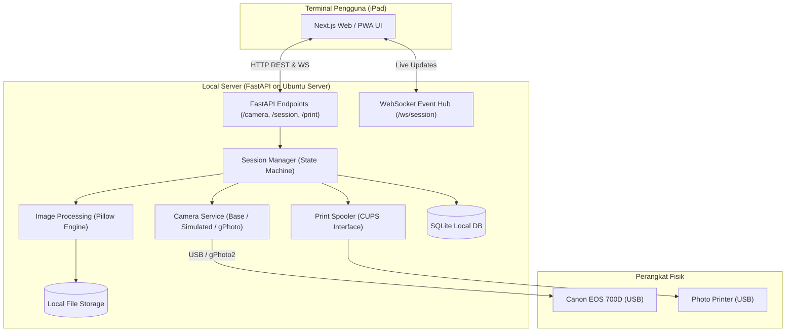
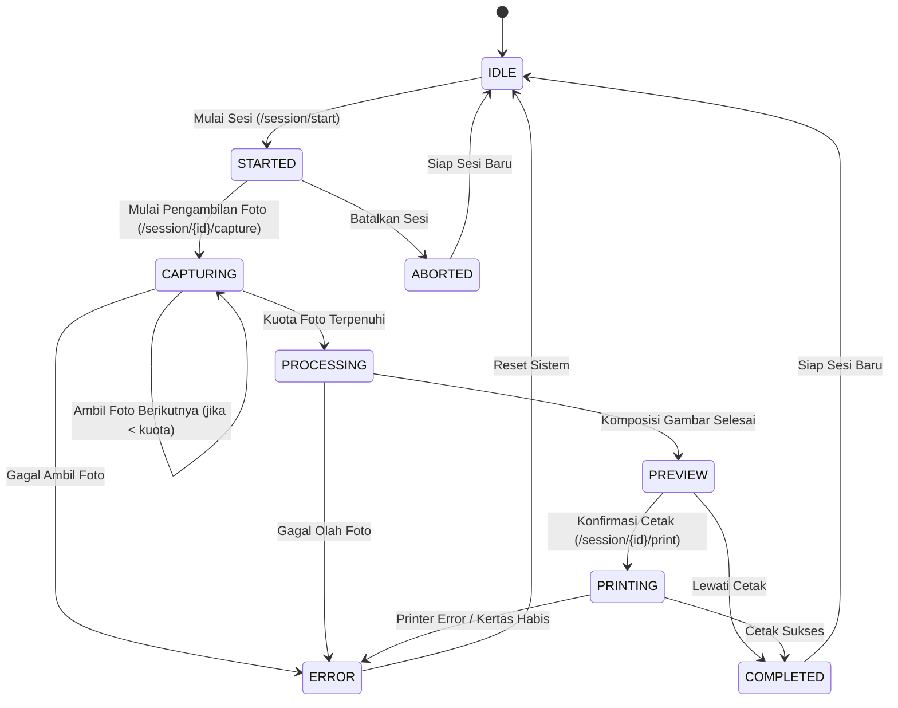

# Dokumentasi Sistem Photobooth Otomatis (Dryu Photobooth)

> Sumber rujukan utama rancangan arsitektur, spesifikasi sistem, alur sesi, struktur data, dan panduan teknis implementasi.

---

## 1. Ringkasan Sistem
Sistem ini dirancang untuk mengoperasikan photobooth otomatis secara independen (*offline-capable* / *local-first*) menggunakan:
- **iPad** sebagai terminal interaksi layar sentuh (*Kiosk Frontend*).
- **Mini PC / VM Linux (Ubuntu 24.04 LTS)** sebagai server lokal yang mengorkestrasi seluruh alur bisnis, kamera, pemrosesan gambar, dan printer.
- **Canon EOS 700D** sebagai kamera DSLR utama melalui koneksi USB tethering.
- **Printer Foto** untuk mencetak foto instan.

---

## 2. Arsitektur dan Alur Komunikasi



### Prinsip Utama:
1. **Frontend Terisolasi dari Hardware:** iPad tidak pernah menyentuh kamera atau printer secara langsung. Semua perintah dikirim ke backend melalui HTTP/WebSocket.
2. **Eksklusivitas Akses Kamera:** Backend memegang hak akses eksklusif kamera untuk mencegah konflik device busy.
3. **Hardware Abstraction Layer (HAL):** Semua implementasi kamera menurunkan `CameraInterface` yang sama, sehingga mode `SimulatedCamera` dan `GPhotoCamera` dapat ditukar hanya melalui konfigurasi (`CAMERA_DRIVER`).

---

## 3. Siklus Hidup Sesi (State Machine)

Sesi photobooth berjalan menggunakan mesin status yang terdefinisi ketat:



### Penjelasan Status:
- **`IDLE`**: Menunggu pelanggan. Layar iPad menampilkan screensaver / *Tap to Start*.
- **`STARTED`**: Pelanggan memulai sesi, memilih template atau jumlah foto.
- **`CAPTURING`**: Hitung mundur aktif (misal 5, 4, 3, 2, 1) -> kamera memotret -> transfer foto ke penyimpanan lokal.
- **`PROCESSING`**: Menggabungkan foto-foto hasil jepretan ke template yang dipilih, menambahkan watermark, dan membuat thumbnail.
- **`PREVIEW`**: Menampilkan hasil cetak di layar iPad untuk verifikasi pengguna.
- **`PRINTING`**: Mengirim dokumen ke antrean printer lokal (CUPS).
- **`COMPLETED`**: Sesi selesai, sistem membersihkan status dan kembali ke `IDLE`.
- **`ERROR`**: Kondisi anomali yang membutuhkan penanganan atau reset.

---

## 4. Struktur Direktori Proyek

Proyek memisahkan secara tegas antara kode aplikasi produksi dan pengujian:

```text
photobooth-system/
├── system-doc.md          # Dokumen arsitektur sistem
├── tools.md               # Inventaris perangkat lunak dan keras
├── README.md              # Petunjuk instalasi dan penggunaan
├── .gitignore             # Aturan pengabaian Git
├── .env.example           # Contoh variabel konfigurasi lingkungan
│
├── backend/               # KODE PRODUKSI BACKEND
│   ├── app/
│   │   ├── main.py        # Titik masuk FastAPI
│   │   ├── api/           # Router HTTP & WebSocket
│   │   ├── core/          # Konfigurasi aplikasi & event
│   │   ├── models/        # Entitas database & model bisnis
│   │   ├── schemas/       # Skema validasi Pydantic
│   │   └── services/      # Layanan: camera, session, image, printer, storage
│   ├── requirements.txt
│
├── frontend/              # KODE PRODUKSI FRONTEND (Next.js Kiosk)
│
├── storage/               # PENYIMPANAN DATA LOKAL (Non-Git)
│   ├── captures/          # Foto mentah dari kamera
│   ├── processed/         # Foto hasil komposisi akhir
│   ├── thumbnails/        # Thumbnail ringan untuk UI preview
│   └── exports/           # File ekspor
│
├── templates/             # Aset template bingkai foto (PNG overlay)
│   ├── layouts/
│   └── assets/
│
├── tests/                 # KODE PENGUJIAN (TERPISAH DARI PROD)
│   ├── unit/              # Uji unit komponen (kamera, state machine, image processor)
│   ├── api/               # Uji endpoint REST API & response status
│   ├── simulation/        # Uji simulasi alur ujung-ke-ujung (E2E workflow)
│   └── conftest.py        # Fixture dan konfigurasi pytest
│
└── docs/                  # Dokumentasi teknis terperinci
```

---

## 5. Ringkasan Endpoint API Awal

| Method | Endpoint | Fungsi | Status |
| :--- | :--- | :--- | :--- |
| `GET` | `/health` | Pemeriksaan kesehatan server dasar | Siap |
| `GET` | `/camera/status` | Mengecek status koneksi kamera | Siap |
| `POST` | `/camera/capture` | Memerintahkan jepretan langsung kamera | Siap |
| `POST` | `/session/start` | Menginisialisasi sesi photobooth baru | Siap |
| `GET` | `/session/current` | Mengambil status sesi yang sedang aktif | Siap |
| `GET` | `/session/{id}` | Mengambil detail sesi berdasarkan ID | Siap |
| `POST` | `/session/{id}/capture` | Menjalankan jepretan dalam konteks sesi aktif | Siap |
| `POST` | `/session/{id}/process` | Memproses komposisi gambar sesi | Siap |
| `POST` | `/session/{id}/complete`| Menyelesaikan sesi dan reset ke IDLE | Siap |
| `POST` | `/session/{id}/abort` | Membatalkan sesi dan reset | Siap |
| `GET` | `/ws/session` | WebSocket untuk live updates & hitung mundur | Siap |
